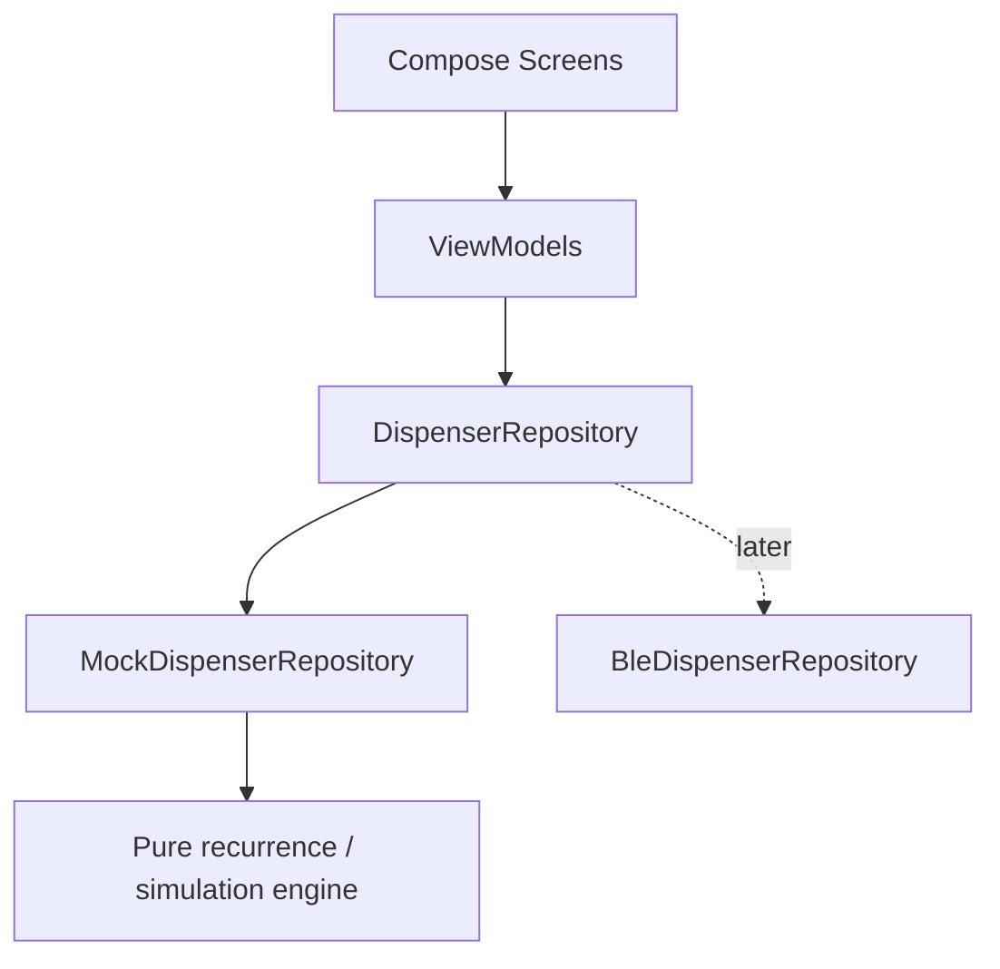

# Dispenser v2 — Android app specification & first agent assignment

Status: Draft 0.1 (2026-11-14). **Independent of physical ESP32 hardware during initial development.** Review product decisions before BLE integration. Companion specs: `REQUIREMENTS_DRAFT.md`, `ARCHITECTURE.md`.

## Product goal

Native Android application for creating, editing, reviewing, and eventually synchronizing liquid-carbon dosing schedules with a battery-powered XIAO ESP32-C3. The primary interaction is **calendar-like scheduling**, not configuring motor run time. User works in ml and local times. All major UI flows must run in a demonstrable **mock-device mode** before hardware exists.

## Technical stack

- Kotlin, Jetpack Compose + Material 3, Material icons, AndroidX Navigation.
- ViewModel + immutable UI state + unidirectional data flow; Kotlin coroutines, StateFlow.
- Domain model independent of Android platform, with deterministic recurrence generation and unit tests.
- Repository interface implemented initially by `MockDispenserRepository` / `FakeDispenserTransport`; later a `BleDispenserRepository` adapter. Explicit `ConnectionState` and `SyncState` surfaced to UI.
- Optional Room for persistence of cached device snapshots, local drafts and mock state. Prefer clear separation between cached **device-confirmed** configuration and local **pending** edits; do not equate locally saved changes with applied device configuration.
- No cloud login, push notification backend, live Bluetooth scanning, real firmware contract or Android background service in milestone A1.
- Use stable pinned toolchain, Kotlin, Gradle, Android Gradle Plugin, and Compose BOM versions compatible with the installed Android Studio; document exact versions in README and version catalog. Avoid ad-hoc upgrade to pre-release packages.

## Initial user journeys

### A. First launch / demo

1. Show a friendly landing screen with `Try demo` and a disabled or explicitly `Coming later` physical-device connection action.
2. Demo starts immediately with seeded sample plans, reservoir estimate, battery estimate and event history. Nothing requires Bluetooth permission.
3. Show a persistent **DEMO** badge so simulated measurements are never mistaken for a real aquarium device.

### B. Calendar as main navigation

- Week view by default (clear days, doses and total ml per day), switch to month/agenda and day detail.
- Tapping day shows its occurrences in time order and daily total. Selecting an occurrence opens the corresponding recurring event definition.
- Clear actions: `New dose`, `Edit`, `Enable/disable`, `Delete` (with confirmation), `View next occurrences`.
- No need for calendar provider permission; this is an **internal dosing calendar**, not Google Calendar integration.

### C. Create/edit event

Fields:

```text
schedule_id: stable UUID
revision: integer
name: optional human-readable label
enabled: boolean
amount_ml: decimal (validate positive, within configured limits)
start_local_date: ISO local date
local_time: HH:mm
timezone: Europe/Prague (explicitly shown, not silently based on phone travel location)
recurrence:
    kind: ONCE | DAILY | WEEKLY | MONTHLY
    interval: integer >= 1
    weekdays: set of weekdays (WEEKLY)
    day_of_month: 1..31 (MONTHLY)
    optional_end_local_date: ISO local date
```

User-friendly repeat choices: Once, Every day, Every N days, Every week, Selected weekdays, Every N weeks, Every month. Include a small **next 5 occurrences** preview before saving. Disallow invalid/inconsistent combinations.

The exact meaning of monthly recurrence on unavailable dates (e.g. 31 February) and optional fixed elapsed `every N hours` is **not yet approved**; avoid silently inventing behavior. For milestone A1, prefer date skipping for unavailable monthly dates and label that as a proposal pending product review.

### D. Overview and reservoir

- Large next planned dose (time + ml) and next 7 days total.
- Reservoir capacity, estimated remaining ml and days-until-empty based on future schedule. All predictions flagged `estimated`; never imply actual fluid level was measured.
- Battery percentage in demo mode is simulated, not physical measurement.
- Refill action prompts for new remaining volume and records refill in demo event history; real mode will later require BLE confirmation from ESP.

### E. History and diagnostics

- Reverse chronological list: scheduled, completed, skipped, blocked (insufficient stock), interrupted/uncertain, refill, battery warnings.
- Filters by date/outcome; details show requested ml, runtime if known, timestamp validity and source (mock or actual device).
- Demo engine can advance its simulated clock by hours/days to generate history and demonstrate missed doses and stock blocking. Time simulation affects only demo domain state, never device time.

## Mock vs physical device model



`DispenserRepository` should expose flows/suspend operations for:

- `observeDevice()`, `observeSchedules()`, `observeEvents()`, `observeReservoir()`;
- `createSchedule(draft)`, `updateSchedule(id, expectedRevision, draft)`, `deleteSchedule(id, expectedRevision)`;
- `simulateTo(instant)`, `refill(amountMl)` in demo mode;
- `requestManualDose(amountMl)` — **demo only initially**, gated behind confirmation and simulated safety limits.

Immutable `Schedule` and `DoseOccurrence` domain types belong in a platform-independent Kotlin module where feasible. UI should not reach directly into BLE APIs or Room entities.

### Sync semantics

- `Applied`: read back and confirmed by physical ESP (future BLE mode).
- `Pending`: locally edited, but not yet confirmed on the device.
- `Failed/Conflict`: device rejected or its revision differs; user must explicitly resolve.
- Demo mode can simulate round-trip acknowledgement, but MUST show DEMO state.
- A phone may show cached history offline; never claim an offline edit changed the physical dosing behavior.

## Navigation outline

```text
Onboarding -> Demo / device selection
Home       -> Next dose, reservoir, battery, active warnings
Calendar   -> Week / month / agenda -> day -> schedule editor
History    -> events, filters, details
Settings   -> demo controls, timezone, future device connection
```

Use Czech for default UI strings (user's primary language), structured string resources for future EN translation, consistent ml units and 24-hour time. Support dark theme, accessibility labels and typical phone screens (including Samsung S23).

## A1 deliverables / acceptance criteria

1. Android Studio project compiles from clean checkout. README documents setup and build/run steps, selected minimum SDK and dependency versions.
2. Demo mode launches **without any hardware, Bluetooth or account**; seeded realistic data is visually identified as simulated.
3. Calendar week view, day detail and at least one agenda view work; navigation is stable on rotation/process recreation where appropriate.
4. User can create, edit, enable/disable and delete a dosing schedule with daily/weekly rules and a reliable next-occurrence preview. Monthly and one-off may be implemented if tested; no unvalidated UI controls.
5. Multiple independent events per day and weekly-only schedule work. Missed occurrences are skipped, never caught up.
6. Mock reservoir decreases on simulated completed doses, blocks when estimated stock cannot cover the next scheduled dose and unblocks after simulated refill confirmation. One low alert per low-stock episode in demo history.
7. Unit tests cover recurrence math (daily/weekly/N-interval), DST Europe/Prague, missed dose skip, stock block and event editing/revisions. UI smoke tests cover creating and editing schedules.
8. No real dose command, Wi-Fi credentials, secrets, cloud calls or Bluetooth permissions are required by this milestone.

## Agent instructions — first implementation milestone (copy into coding agent)

> Work only on Android milestone **A1 — offline demo application**. Read this specification, `REQUIREMENTS_DRAFT.md` and `ARCHITECTURE.md` before editing. Start by presenting a concise plan, module design and pinned Android toolchain choices. Create the Android Studio Gradle project under `android/` in the Dispenser monorepo. Implement Kotlin/Jetpack Compose with a mock repository and a pure recurrence engine. Build the calendar-first flow, create/edit recurrence form, simulated stock and event history; add unit tests. Do not implement BLE transport or cloud/backend yet. Keep all firmware-facing APIs behind interfaces and distinguish local pending edits from applied settings. Avoid claiming successful device synchronization in demo. Run the available Gradle verification tasks and report exact results, gaps and any toolchain blockers. Stop at the milestone boundary for review before adding features.

## Implementation status (2026-11-15)

Implemented in `android/` (see `android/README.md`): A1.1 shell and dashboard, A1.1.1 dark Material 3 design system, A1.2a calendar (month/week, selected-day details, dashboard deep link), A1.2b schedule editor and A1.2c local schedule persistence.

- **Persistence (A1.2c):** schedules are stored on the phone with Room and survive restarts. A fresh install starts with no schedules (no demo seed). Amounts are stored as integer microlitres. The running app uses the phone's real clock. Stored records that cannot be loaded are kept untouched and reported as a non-blocking warning in Rozvrhy.
- **DST for one-off doses (approved 2026-11-15):** a ONCE schedule whose local date/time does not exist (spring-forward gap) cannot be saved; recurring schedules keep the skip/once rule (FR-015).

- **Calendar journey (B):** month/week views and day details are done. Tapping an occurrence opens the editor for the whole recurring schedule. A **Rozvrhy** list under the day details shows all schedules, including disabled ones, with enable/disable switches. Disabled schedules have no calendar occurrences. There is no separate per-schedule visibility setting.
- **Create/edit (C):** ONCE, DAILY every N days and WEEKLY every N weeks with weekdays, optional inclusive end date, enabled flag, next-5 preview, and validation without physical pump limits. The start date is prefilled from the selected day. Delete asks for confirmation; leaving with unsaved changes asks to discard. A floating Save button stays disabled while the form is invalid or unchanged. MONTHLY is not offered (missing-date rule undecided).
- **Sync semantics:** every saved schedule is `PENDING`, displayed as "Uloženo v telefonu": stored locally, not transferred to or accepted by the device. No acknowledgement is simulated; `DEVICE_APPLIED` is reserved for future BLE read-back. The DEMO badge stays because device values are simulated.
- **A1.3 dispensing simulation:** deterministic engine with a separate persisted `simulation.db`, Settings controls (start, +1 h, +1 day, advance to, outage, reset), a visible simulation clock while active, reservoir detail with prediction and refill, and a newest-first History screen with events marked SIMULACE. Service mode / tubing priming (FR-025) is documented and reserved only.
- **A1.4a settings and branding:** sectioned Settings (app, reservoir summary, simulation, device placeholder "Zařízení není připojeno"), persisted aquarium name (DataStore), adaptive launcher icon and Android 12+ splash in brand colors, version 0.4.0.
- **A1.4b app information:** About screen (version from package metadata, changelog, generated third-party licenses, undecided app license), user-initiated GitHub Releases update check with explicit stable/beta channel rules; repository private for now, so the check reports unavailable metadata. Release process in `docs/RELEASING.md`.
- **Not yet done:** onboarding screen (A); history filters (E); BLE, real battery measurement, service mode.
- **Known limitation:** the M3 date picker grid follows the device language for month/day names.

## Open questions for next product review

1. Is `every N hours` (duration from anchor time) needed in addition to calendar recurrence? This differs across DST.
2. Maximum schedules and allowed ml/dose/day; whether hourly UI is useful for actual aquarium use.
3. Should demo begin with a preset aquarium and sample schedules, or with an empty calendar plus guided onboarding?
4. Day-of-month invalid-date policy (skip vs last day), end conditions and exceptions to one recurrence occurrence.
5. Final BLE protocol, pairing/authorization, device discovery and state conflict UX.
