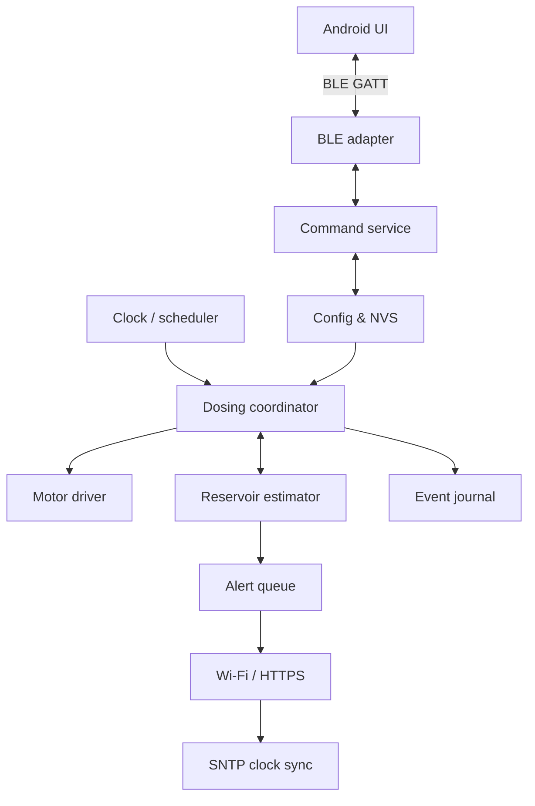
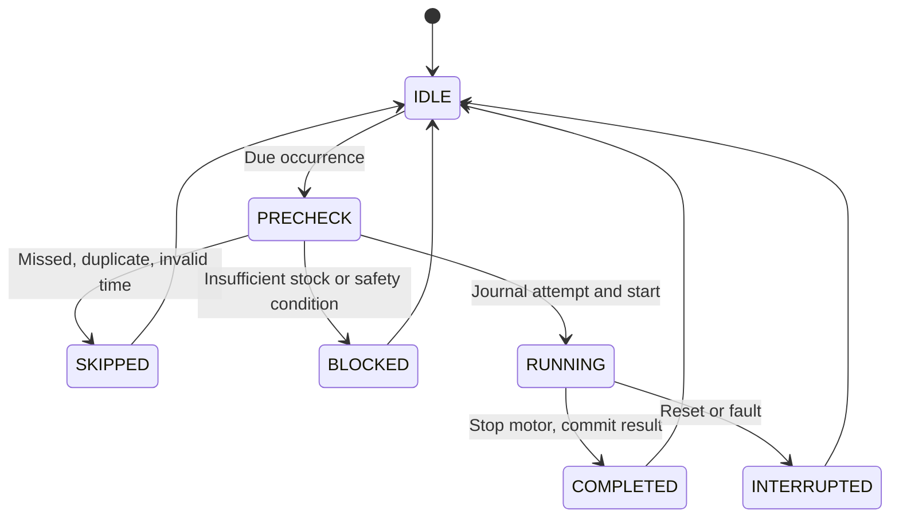
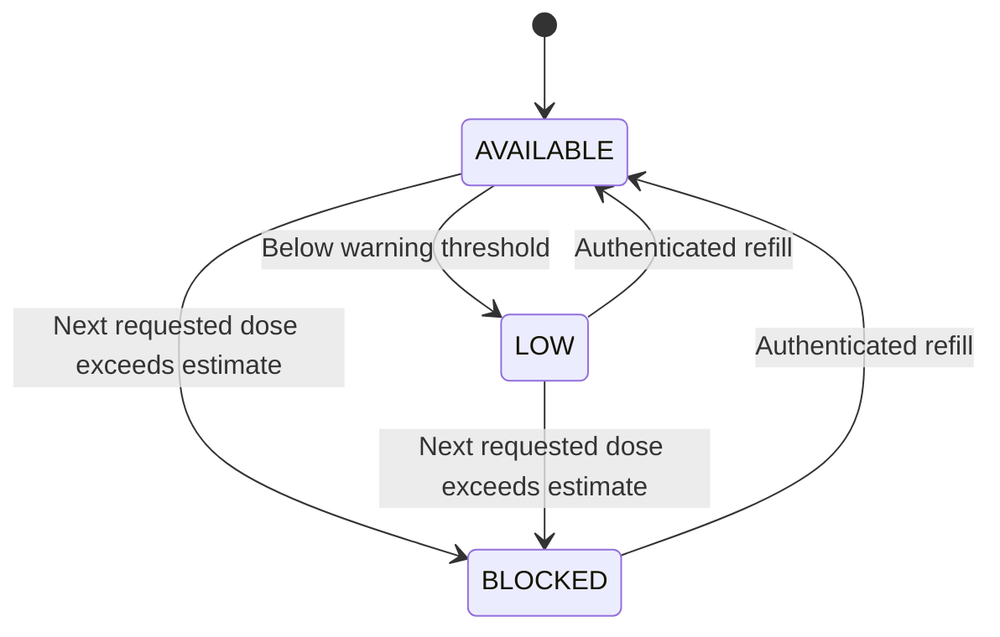

# Dispenser v2 — Software architecture

Status: Draft 0.2, 14 Nov 2026. Companion to `REQUIREMENTS_DRAFT.md` and `DISPENSER_V2_SPEC.md`.

## Design goals and non-goals

- **Safety over exact millilitre accuracy**: never accidentally overdose after reboot/time changes. Dose is estimated from calibrated motor runtime; hardware flow feedback is absent.
- Autonomous and local-first: scheduled dispensing must not depend on BLE, Wi-Fi or backend availability.
- Deep sleep between timer/button wakeups. Radio only active as needed.
- Android application is a BLE GATT client; Wi-Fi used transiently for SNTP and event-driven HTTPS notifications.
- No permanent web server, cloud account, screen, always-on connection, or liquid-level sensor in the first iteration.

## Logical components



Keep all business-domain components (`scheduler`, `dosing coordinator`, `stock estimator`, `event journal`) independent of ESP-IDF APIs using interfaces for clock, persistence and motor. GPIO, NVS, BLE and Wi-Fi are infrastructure adapters.

## Boot / wake sequence

1. First instruction leaves motor gate in a **safe-off** hardware state; verify boot pin behavior separately.
2. Read reset/wakeup cause, validate NVS configuration, journal and time validity.
3. Recover unfinished dose attempt (if any), mark `INTERRUPTED_UNCERTAIN`, **never run it again automatically**.
4. On button wake, enter authorized BLE maintenance mode; on timer wake, evaluate due schedule occurrence(s) using known valid time.
5. If a due dose is valid, check enabled flag, event deduplication, bounded daily limits, battery conditions, stock sufficiency and pump maximum runtime.
6. Journal `STARTED`/attempt intent durably **before** energizing motor. Pump runs with watchdog/timeout; turn OFF first, then journal completion and update remaining stock.
7. If notification or sync is due, bring Wi-Fi up with bounded timeout; otherwise leave radio off.
8. Compute next wake based on schedule/sync needs, arm timer + button wake, shut radio down, enter deep sleep.

### A deliberate trade-off: exactly-once vs no accidental repeat

With no measured liquid flow and no transactional actuator, truly *exactly-once* dosing is impossible across arbitrary power failures. Choose **at-most-once automatic actuation** for each occurrence: a crash after durable `STARTED` may result in a missed/partial dose, but should never cause an automatic duplicate dose. Surface the event as uncertain in logs and Android.

## Domain state machines

### Dosing operation



No catch-up dosing. Configurable **recurring calendar events** are independent, including weekly and other user-defined periods, not just daily slots. Schedule occurrence ID must be stable across reboot. Consider UTC timestamp plus local-date/event/revision/timezone disambiguation for DST. During DST fall-back a local occurrence must not trigger twice; DST forward skips nonexistent time, unless specified otherwise.

### Calendar-style recurrence model

Use a **bounded subset inspired by iCalendar RFC 5545**, with a user-friendly Android editor and an explicit internal schema. Do not claim full RRULE support. Proposed first iteration:

- `ONCE`: once on a concrete local date and time.
- `DAILY`: every `interval` days, e.g. every day or every third day.
- `WEEKLY`: every `interval` weeks on selected weekdays, e.g. Monday/Thursday or every other Saturday.
- `MONTHLY`: a selected day-of-month, optionally every N months; handling of missing dates (29–31) to be confirmed.
- Each event carries a stable ID, start date, local time, volume, enabled flag, optional end date, anchor/interval and rule revision. Multiple events may share the same day/time; execute in a deterministic order under daily maximum and stock constraints.
- Scheduler must be pure: `nextOccurrence(rule, after_utc, timezone)` and `dueOccurrences(start_utc, end_utc)` with bounded work. Persist/reconstruct occurrence IDs independently of next-wakeup computation.
- No fixed-interval `N hours` mode until the product confirms whether intervals should follow wall-clock local dates or elapsed time; they behave differently at DST boundaries.

**Android implementation status (A1.2b, 2026-11-15).** The rules above, minus MONTHLY, are implemented as the pure Kotlin `RecurrenceEngine` (`android/app/src/main/java/cz/nowass/dispenser/domain/`), shared by the dashboard, calendar and editor preview:

- ONCE, DAILY every N days (anchored on the start date), WEEKLY every N weeks on selected weekdays (weeks counted from the Monday of the start week, never before the start date), and an inclusive optional end date.
- DST per FR-015: spring-forward gap times are skipped; fall-back repeated times yield one occurrence at the earlier instant.
- Queries return only occurrences strictly after a given instant, so missed doses are never caught up.
- `PROPOSED`, pending review: occurrence ID = `scheduleId@localDate`, independent of revision. This means at most one occurrence per schedule per local date, and editing a schedule cannot create a second occurrence for a date already handled. Multiple daily doses use multiple schedules.
- Schedule writes use optimistic concurrency (`expectedRevision`; the revision is incremented on every update, a mismatch is a conflict).
- A1.2c: schedules are persisted on the phone (Room, `schedules` table) with amounts as integer microlitres and weekdays as `weekdays_mask` (bit 0 = Monday), matching the data model sketch above. Locally saved schedules are `PENDING` until a future device read-back; the phone copy is never treated as applied device configuration.

RFC 5545 is a reference for recurrence vocabulary (`FREQ`, `INTERVAL`, `BYDAY`), **not** a requirement to implement an arbitrary text RRULE parser on the MCU.

### Reservoir state



Store `reservoir_capacity_ml`, `estimated_remaining_ml`, `low_alert_sent_for_episode`, `blocked_alert_sent_for_episode`, `refill_epoch`, and last committed dispensing action. Use event IDs to deduplicate on-device and server-side. Stock is a modeled estimate, so never promise true empty detection. If a dose is interrupted, record estimated delivered amount as unknown rather than asserting complete success; choose a conservative policy before release.

## Data model sketch

```text
Configuration:
  schema_version: uint16
  timezone: "Europe/Prague"
  schedules: [{schedule_id, revision, enabled, start_local_date,
               time_local_hhmm, volume_ml, recurrence: {kind, interval,
               weekdays_mask?, day_of_month?, end_local_date?}}]
  pump_calibration: {millilitres_per_second, measurement_voltage_mv?, timestamp}
  safety: {max_single_ml, max_daily_ml, max_run_ms}
  reservoir: {capacity_ml, estimated_remaining_ml, refill_epoch}
  clock: {last_good_sync_utc, source, valid}
  wifi: {ssid, credential_ref, sync_policy}
  notifications: {endpoint, device_token_ref, alert_policy}

DoseOccurrence:
  {occurrence_id, schedule_id, schedule_revision, local_date, scheduled_utc,
   requested_ml, state, started_utc, elapsed_ms?, error_code?}

Event:
  {seq, event_id, time_utc?, time_valid, type, occurrence_id?, details}
```

The actual binary/wire format must be versioned; no schema above should be implemented literally until storage/transport decisions are reviewed. Keep secrets in protected storage and exclude them from logs.

## Persistence and flash health

- NVS for small infrequently modified configuration, alert latches and essential checkpoint state.
- Size-bounded durable event history, not a high-frequency trace. Prefer append records or a controlled ring/log partition with recovery and testable wear limits; only persist event boundaries.
- Use crash-tolerant records and explicit version/migration logic. Commit `STARTED` before GPIO activation, commit `COMPLETED` after motor OFF; avoid coupling GPIO transitions to fragile multi-key updates.
- Journal-write failure must prevent actuator start (fail-safe).

## Wireless APIs

### BLE

- Button wake starts advertising for default 3 min; maintain while connected; disconnect returns to sleep after bounded grace period.
- Versioned GATT service supporting `device_status`, `get/set_schedule`, `get/set_calibration`, `get_logs(cursor,limit)`, `confirm_refill`, `manual_dose`, `set_wifi`, `sync_time`.
- Authenticate all writes and protect against replay/duplicate commands. Use transaction IDs and errors; do not assume one GATT packet fits arbitrary structured payload.
- Android app should support a mock repository/transport so UI can be developed before hardware arrives.

### Wi-Fi

- STA only, connect for SNTP when due or HTTPS alert when queued; connect/TLS/HTTP each with strict timeouts and backoff.
- Endpoint should be minimal and credential-scoped per device; send immutable `event_id` and no sensitive personal data beyond what is necessary.
- No periodic heartbeat or status email per user decision. A time-sync-only connection remains allowed at infrequent configurable cadence.
- Failed alerts cannot cause an infinite Wi-Fi retry loop; preserve pending status until a bounded future retry opportunity or BLE maintenance.

## Dependency boundaries and test doubles

```text
IClock         now_utc(), is_valid(), next_wakeup()
IActuator      set_enabled(bool), force_off()
IStorage       load_config(), commit_attempt(), commit_result(), append_event()
IBattery       read_mv(), is_safe_to_run()
INotifier      queue_event(), try_flush()
```

Host-side deterministic tests must cover missed dose, multiple daily schedules, once-a-week schedules, every-N-days, weekly day masks, monthly boundaries, editing an existing recurring schedule, DST edges, reboot between `STARTED` and `COMPLETED`, insufficient reservoir, refill rearming, invalid time, notification dedupe, network timeout, storage failure, and minimum/maximum pulse behavior.

## Staged development and verification

1. **M0**: ESP-IDF CMake skeleton, target `esp32c3`, build/flash/monitor, deep sleep + GPIO wake, safe motor-off pin behavior (without motor).
2. **M1**: pure business components and host tests, fake motor/time/storage, confirmed schedule semantics.
3. **M2**: motor hardware tests with water, voltage/current/flow characterization; tune limits and calibrate.
4. **M3**: authenticated BLE protocol and Android app screens; mock mode and hardware integration.
5. **M4**: SNTP and event-triggered HTTPS alert path.
6. **M5**: power budget, RTC drift, crash/brownout, endurance and enclosure validation.

## Open architectural decisions

- Maximum schedules and max ml/dose/day/time; recurrence subset, monthly short-month behavior, optional hourly repeat; calibration approach and voltage compensation.
- Whether to hold blocked stock until refill even after manual adjustments; manual dosing under low stock.
- Behavior of interrupted dose against estimated reservoir volume.
- Clock synchronization frequency and fallback for full power loss.
- BLE authentication mechanism and GATT payload protocol.
- Storage partition sizing, alert backend/provider and OTA strategy.
- Battery voltage measurement hardware and protective cutoff design.
