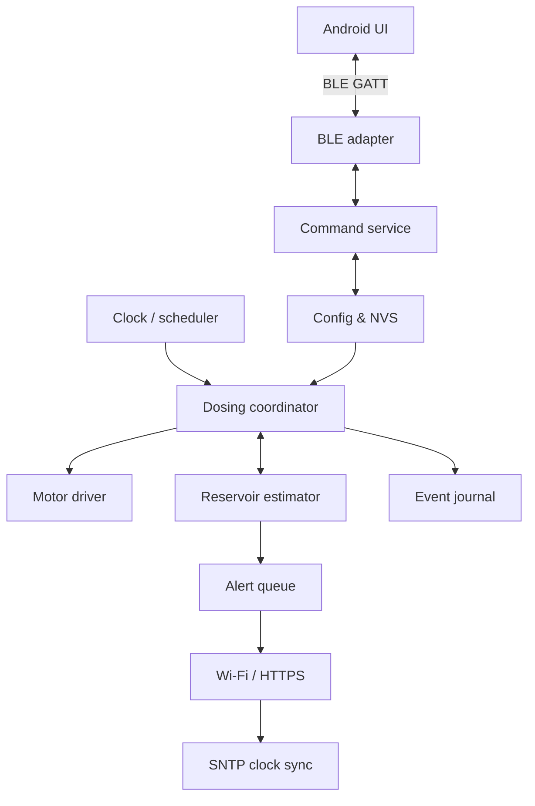
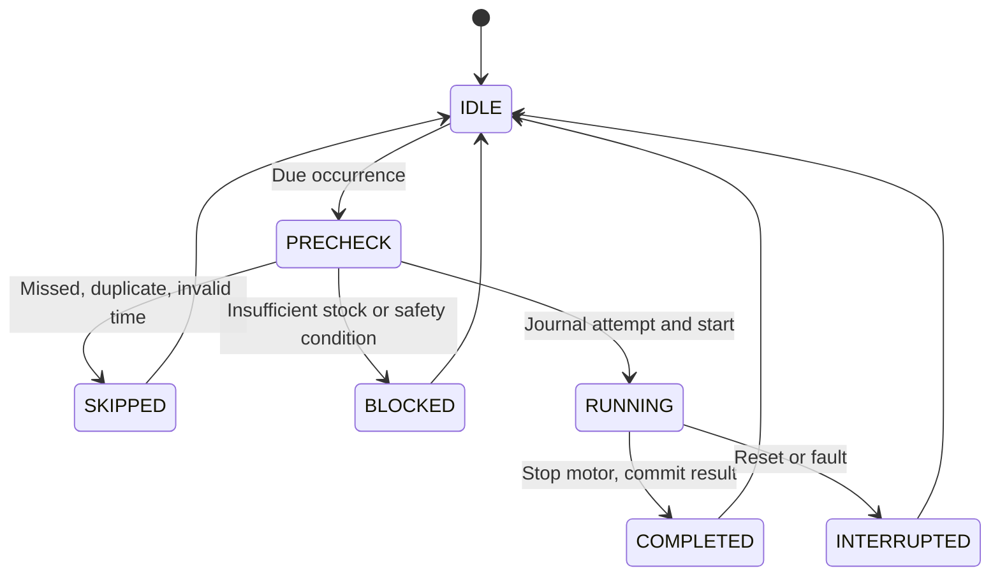
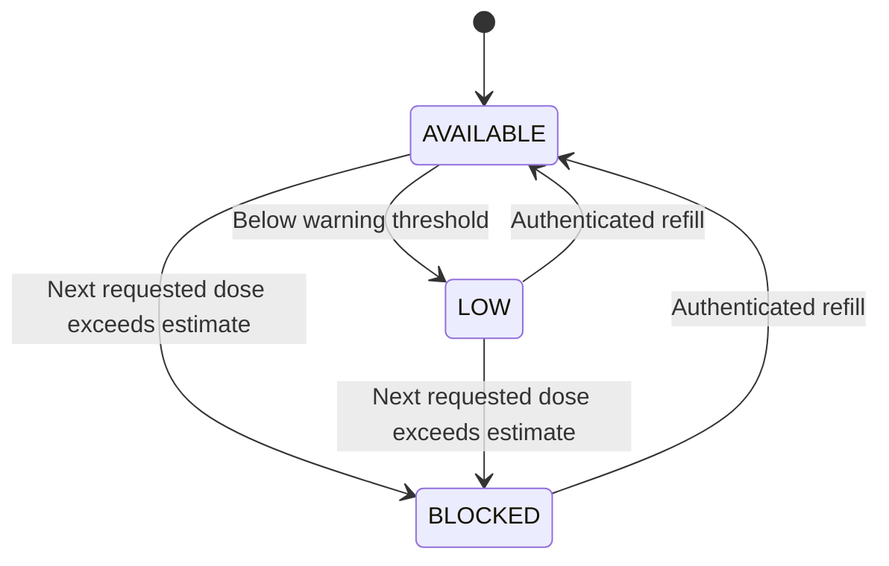
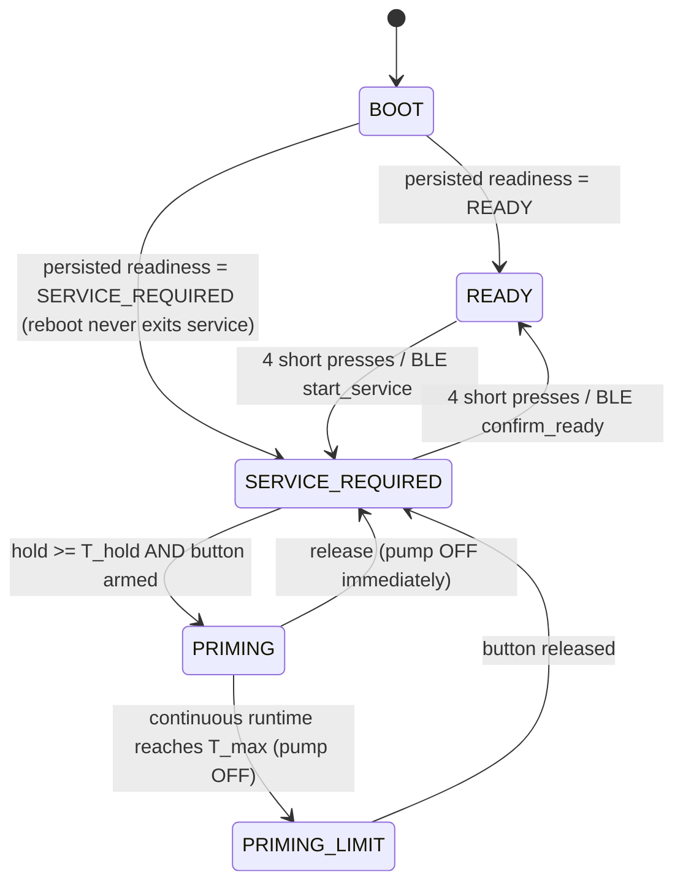

# Dispenser v2 — Software architecture

Status: Draft 0.2, 14 Nov 2026. Companion to `REQUIREMENTS_DRAFT.md` and `DISPENSER_V2_SPEC.md`.

## Design goals and non-goals

- **Safety over exact millilitre accuracy**: never accidentally overdose after reboot/time changes. Dose is estimated from calibrated motor runtime; hardware flow feedback is absent.
- Autonomous and local-first: scheduled dispensing must not depend on BLE, Wi-Fi or backend availability.
- Deep sleep between timer/button wakeups. Radio only active as needed.
- Android application is a BLE GATT client; Wi-Fi used transiently for SNTP and event-driven HTTPS notifications.
- No permanent web server, cloud account, screen, always-on connection, or liquid-level sensor in the first iteration.

## Logical components



Keep all business-domain components (`scheduler`, `dosing coordinator`, `stock estimator`, `event journal`) independent of ESP-IDF APIs using interfaces for clock, persistence and motor. GPIO, NVS, BLE and Wi-Fi are infrastructure adapters.

## Boot / wake sequence

1. First instruction leaves motor gate in a **safe-off** hardware state; verify boot pin behavior separately.
2. Read reset/wakeup cause, validate NVS configuration, journal and time validity.
3. Recover unfinished dose attempt (if any), mark `INTERRUPTED_UNCERTAIN`, **never run it again automatically**.
4. On button wake, enter authorized BLE maintenance mode; on timer wake, evaluate due schedule occurrence(s) using known valid time.
5. If a due dose is valid, check enabled flag, event deduplication, bounded daily limits, battery conditions, stock sufficiency and pump maximum runtime.
6. Journal `STARTED`/attempt intent durably **before** energizing motor. Pump runs with watchdog/timeout; turn OFF first, then journal completion and update remaining stock.
7. If notification or sync is due, bring Wi-Fi up with bounded timeout; otherwise leave radio off.
8. Compute next wake based on schedule/sync needs, arm timer + button wake, shut radio down, enter deep sleep.

### A deliberate trade-off: exactly-once vs no accidental repeat

With no measured liquid flow and no transactional actuator, truly *exactly-once* dosing is impossible across arbitrary power failures. Choose **at-most-once automatic actuation** for each occurrence: a crash after durable `STARTED` may result in a missed/partial dose, but should never cause an automatic duplicate dose. Surface the event as uncertain in logs and Android.

**Firmware implementation status (M1.2, 2026-11-15, pending review).** Steps 3, 5 (deduplication, timing, clock validity, enabled flag) and 6 (durable `STARTED` before actuation, outcome afterwards) are implemented as pure domain code in `firmware/components/dispenser_domain` (`dsp_exec.h`, `dsp_history.h`) and host-tested with a fault-injecting fake store; details in `firmware/README.md` "Execution history and deduplication". Approved decisions:

- An automatic occurrence may run only while `scheduled ≤ now ≤ scheduled + 10 min` (due window, configurable) and only with a valid clock; later it is `MISSED` and never caught up.
- A claim is a durable `STARTED` record (write, commit, read-back) **before** the pump is authorized; any storage failure means no pump. Records in any state (`STARTED`, `COMPLETED`, `FAILED`, `INTERRUPTED`) block re-execution; nothing is retried automatically. At boot, leftover `STARTED` records become `INTERRUPTED`.
- History = **one watermark record per schedule ID** (last claimed local date), **32 slots by default** (approved). It blocks that date and all earlier dates, also after a backward clock correction while the record exists. Records of other schedules may be reused (oldest first, only when full) once their date is more than **7 days** old. This is safe because such occurrences are missed anyway, **assuming the valid clock never moves back more than 7 days**. Since M1.4 this assumption is enforced: a sync moving the clock back more than 7 days holds automatic dosing until the clock reaches high water − 7 days (see `firmware/README.md`, "Backward clock adjustments"). With no free or reusable slot, a new schedule's claim is refused without touching storage. Any corrupted record or duplicate schedule ID anywhere in the history blocks automatic dosing (approved).
- **Single owner:** the future dosing service task owns the coordinator and the history store and serializes all automatic and manual requests. Storage must replace one record atomically and durably; no multi-record atomicity is assumed.
- Manual doses are separate: they never read, write or clear automatic history.
- Schedule IDs: Android-generated UUIDs are preferred for schedule management (approved), never reused. A newly created schedule (new ID) may dose on the same day as a deleted one (approved).

## Domain state machines

### Dosing operation



No catch-up dosing. Configurable **recurring calendar events** are independent, including weekly and other user-defined periods, not just daily slots. Schedule occurrence ID must be stable across reboot. Consider UTC timestamp plus local-date/event/revision/timezone disambiguation for DST. During DST fall-back a local occurrence must not trigger twice; DST forward skips nonexistent time, unless specified otherwise.

### Calendar-style recurrence model

Use a **bounded subset inspired by iCalendar RFC 5545**, with a user-friendly Android editor and an explicit internal schema. Do not claim full RRULE support. Proposed first iteration:

- `ONCE`: once on a concrete local date and time.
- `DAILY`: every `interval` days, e.g. every day or every third day.
- `WEEKLY`: every `interval` weeks on selected weekdays, e.g. Monday/Thursday or every other Saturday.
- `MONTHLY`: a selected day-of-month, optionally every N months; handling of missing dates (29–31) to be confirmed.
- Each event carries a stable ID, start date, local time, volume, enabled flag, optional end date, anchor/interval and rule revision. Multiple events may share the same day/time; execute in a deterministic order under daily maximum and stock constraints.
- Scheduler must be pure: `nextOccurrence(rule, after_utc, timezone)` and `dueOccurrences(start_utc, end_utc)` with bounded work. Persist/reconstruct occurrence IDs independently of next-wakeup computation.
- No fixed-interval `N hours` mode until the product confirms whether intervals should follow wall-clock local dates or elapsed time; they behave differently at DST boundaries.

**Android implementation status (A1.2b, 2026-11-15).** The rules above, minus MONTHLY, are implemented as the pure Kotlin `RecurrenceEngine` (`android/app/src/main/java/cz/nowass/dispenser/domain/`), shared by the dashboard, calendar and editor preview:

- ONCE, DAILY every N days (anchored on the start date), WEEKLY every N weeks on selected weekdays (weeks counted from the Monday of the start week, never before the start date), and an inclusive optional end date.
- DST per FR-015: spring-forward gap times are skipped; fall-back repeated times yield one occurrence at the earlier instant.
- Queries return only occurrences strictly after a given instant, so missed doses are never caught up.
- **Approved 2026-11-15 (FR-014):** occurrence ID = `<scheduleId>@<localDate>`, independent of revision. This means at most one occurrence per schedule per local date, and editing a schedule (time, volume) cannot create a second occurrence for a date already handled. Multiple daily doses use multiple schedules. **Mandatory invariant:** schedule IDs are unique within the device and IDs of deleted schedules are never reused; otherwise a new schedule could inherit the handled-occurrence history of a deleted one. Enforced by the future schedule-management/storage layer.
- Schedule writes use optimistic concurrency (`expectedRevision`; the revision is incremented on every update, a mismatch is a conflict).
- A1.2c: schedules are persisted on the phone (Room, `schedules` table) with amounts as integer microlitres and weekdays as `weekdays_mask` (bit 0 = Monday), matching the data model sketch above. Locally saved schedules are `PENDING` until a future device read-back; the phone copy is never treated as applied device configuration.

**Firmware implementation status (M1.1, 2026-11-15).** The same rules (minus MONTHLY) are implemented in pure C11 in `firmware/components/dispenser_domain` (`dsp_recurrence.h`, `dsp_time.h`); details in `firmware/README.md` "Recurrence engine":

- Instants are signed 64-bit UTC seconds. The timezone is an explicit rule value passed to every query, `Europe/Prague` = CET/CEST with the EU transition rule (last Sunday of March/October, 01:00 UTC), not the C library `TZ`. This matches IANA tzdata for the supported schedule dates 2000-01-01 … 2099-12-31 (approved). A change of DST legislation is handled by a firmware update.
- Disabled schedules produce no occurrences in any firmware query (approved). Volumes are `uint32_t` microlitres (the BLE protocol carries `u32`; the app must refuse larger values, M1.10b.1); a schedule whose amount exceeds the configured per-dose limit is refused at entry.
- Queries: validation (all errors as a bitmask), next occurrence strictly after an instant, bounded range query into a caller buffer (overflow reported, never truncated silently), earliest across a set of schedules. No allocation, no global state, bounded work.
- Parity with the Kotlin engine is enforced by shared test vectors (`test-vectors/`), run by both the firmware host tests and the Android unit tests.
- Occurrence identity `<scheduleId>@<localDate>` (approved, see above) is reproduced unchanged. Durable deduplication, schedule-ID management and execution belong to M1.2/M1.3.

RFC 5545 is a reference for recurrence vocabulary (`FREQ`, `INTERVAL`, `BYDAY`), **not** a requirement to implement an arbitrary text RRULE parser on the MCU.

### Reservoir state



Store `reservoir_capacity_ml`, `estimated_remaining_ml`, `low_alert_sent_for_episode`, `blocked_alert_sent_for_episode`, `refill_epoch`, and last committed dispensing action. Use event IDs to deduplicate on-device and server-side. Stock is a modeled estimate, so never promise true empty detection. If a dose is interrupted, record estimated delivered amount as unknown rather than asserting complete success; choose a conservative policy before release.

## Dispensing simulation and device readiness (A1.3)

The Android app contains a deterministic, pure Kotlin dispensing simulation (`android/app/src/main/java/cz/nowass/dispenser/domain/simulation/`). It doubles as an executable reference for firmware logic:

- `SimulationEngine`: pure functions over an immutable `SimulationState`. Enabled schedules' occurrences in (clock, target] are processed chronologically (time, then schedule id) and at most once (occurrence id). The clock never moves backwards (reset starts a new run). Advancing time means the device is running; an explicit outage records `DISPENSE_SKIPPED` without catch-up. Commands are bounded (366 days, 10 000 occurrences) and excessive ranges are rejected.
- `ReservoirState` (integer µl): 0 < capacity, 0 ≤ remaining ≤ capacity. No partial doses, never negative. Insufficient stock blocks that dose and every following one until a refill (FR-022). Refill sets an absolute remaining volume ≤ capacity and clears the blocked state and the low-stock latch. The low-stock warning (PROPOSED 20 %, configurable) is issued once per episode (FR-007/FR-021).
- `HistoryEvent`: immutable, with origin `SIMULATION` or `DEVICE`. Execution events snapshot the schedule name and requested volume, plus reservoir before/after.
- `ReservoirPredictor`: walks actual future occurrences (not average consumption) within a 365-day / 10 000-occurrence horizon; results beyond it are reported as unknown.

**Device readiness (future service mode, FR-025).** States: `READY` (normal dispensing); blocked by insufficient stock (`ReservoirState.blocked`, cleared by refill); `SERVICE_REQUIRED` (container replacement / tubing priming in progress, dispensing suspended; doses are recorded as skipped with reason `DEVICE_NOT_READY`). Reserved event types: `SERVICE_STARTED`, `TUBING_PRIMED` (priming volume deducted from the estimate), `SERVICE_COMPLETED` (back to `READY`), `DISPENSE_INTERRUPTED_UNCERTAIN`. A1.3 implements none of the service workflow; priming is never part of normal dose execution.

## Service mode state machine (firmware, future — FR-025/FR-026)

Explicit state machine, **separate from the dosing coordinator**. The dosing coordinator only reads the readiness: outside `READY`, due doses are recorded as skipped with reason `DEVICE_NOT_READY` and never caught up. The A1.3 simulation already implements that rule.



**Rules**
- Readiness (`READY` / `SERVICE_REQUIRED`) is persisted durably *before* the transition takes effect. `PRIMING` and `PRIMING_LIMIT` are transient: after any reset the device boots into `SERVICE_REQUIRED` with the pump OFF.
- **Button arming:** after boot or wake the button is unarmed until a release has been debounced, so a button held at boot can never start the pump.
- **Pump drive:** ON only while all of these hold: state = `PRIMING`, button sampled pressed (debounced), continuous runtime < `T_max`, and the watchdog is fed. Any other condition, fault, reset or brown-out means OFF (FR-044; hardware pull-down on the gate).
- Short presses (≤ `T_short_max`) never run the pump, because `T_hold` > `T_short_max`. The 4-press confirm sequence therefore cannot prime by accident.
- **Consumption:** each pump run is journaled with its runtime. Estimated volume = runtime × calibrated flow (FR-011), deducted from the reservoir estimate and flagged uncertain if not calibrated. Reserved history types: `SERVICE_STARTED`, `PRIMING_PUMP_RUN` (one per run, with its estimated volume), `TUBING_PRIMED` / `SERVICE_COMPLETED` (back to `READY`). Reasons: `SERVICE_BUTTON`, `SERVICE_BLE`, `PRIMING_RUNTIME_LIMIT`.
- **BLE:** may start service and confirm readiness. It does not drive the pump in this design. If remote priming is ever added, it needs a dead-man heartbeat (pump OFF when the heartbeat is lost).
- **Wake:** the button must be on a deep-sleep wake-capable GPIO (ESP32-C3: GPIO0–GPIO5). Multi-press counting starts with the wake press.

**Timing parameters (`PROPOSED`, to be validated on hardware)**

| Parameter | Proposed value | Meaning |
|---|---|---|
| Debounce | 30 ms | stable level required before an edge counts |
| `T_short_max` | 400 ms | longest press counted as a short press |
| Inter-press gap | ≤ 500 ms | max release→press gap inside a multi-press sequence |
| Sequence end | 700 ms idle | sequence evaluated after this silence; exactly 4 presses = gesture; 1 press = FR-003 BLE wake; other counts ignored |
| `T_hold` | 800 ms | hold time before the pump starts in `SERVICE_REQUIRED` |
| `T_max` | 10 s | hard maximum continuous priming run (pending pump characterization, FR-016) |

**Feedback (visible).** The XIAO ESP32-C3 has no user LED, so an indicator (e.g. an LED) must be added in hardware. Proposed patterns: gesture recognized → 2 short blinks; `SERVICE_REQUIRED` → slow blink; `PRIMING` → steady on; `T_max` reached → fast blink until release; back to `READY` → one long blink. The Android app mirrors the state once BLE exists.

## Data model sketch

```text
Configuration:
  schema_version: uint16
  timezone: "Europe/Prague"
  schedules: [{schedule_id, revision, enabled, start_local_date,
               time_local_hhmm, volume_ml, recurrence: {kind, interval,
               weekdays_mask?, day_of_month?, end_local_date?}}]
  pump_calibration: {millilitres_per_second, measurement_voltage_mv?, timestamp}
  safety: {max_single_ml, max_daily_ml, max_run_ms}
  reservoir: {capacity_ml, estimated_remaining_ml, refill_epoch}
  clock: {last_good_sync_utc, source, valid}
  wifi: {ssid, credential_ref, sync_policy}
  notifications: {endpoint, device_token_ref, alert_policy}

DoseOccurrence:
  {occurrence_id, schedule_id, schedule_revision, local_date, scheduled_utc,
   requested_ml, state, started_utc, elapsed_ms?, error_code?}

Event:
  {seq, event_id, time_utc?, time_valid, type, occurrence_id?, details}
```

The actual binary/wire format must be versioned; no schema above should be implemented literally until storage/transport decisions are reviewed. Keep secrets in protected storage and exclude them from logs.

**Implemented persistent schema (M1.3, pending review):** layout v1 with versioned, byte-exact little-endian records: `layout` marker, 32 history slots, one schedule-set record (up to 16 schedules plus 16 deleted-ID tombstones), and configuration v1 (reservoir capacity and estimated remaining volume, low-stock threshold, NTP interval 24–48 h, notification mask). Calibration, battery, device identity, Wi-Fi and notification endpoint are **not** in v1; credentials never go into these records. Formats, migration rules and the partition recommendation are in `firmware/README.md`, "Persistent storage and configuration".

## Persistence and flash health

- NVS for small infrequently modified configuration, alert latches and essential checkpoint state.
- Size-bounded durable event history, not a high-frequency trace. Prefer append records or a controlled ring/log partition with recovery and testable wear limits; only persist event boundaries.
- Use crash-tolerant records and explicit version/migration logic. Commit `STARTED` before GPIO activation, commit `COMPLETED` after motor OFF; avoid coupling GPIO transitions to fragile multi-key updates.
- Journal-write failure must prevent actuator start (fail-safe).
- Execution history (M1.2): fixed slots, one record per schedule (32 slots by default, approved; about 3 KB), one blob key per slot with a versioned encoding. Each slot update must be atomic (old or new value after power loss) and durable after `nvs_commit`. Two writes per automatic dose; the coordinator confirms each by reading it back.
- **M1.3 storage (implemented, host-tested; not run on flash):**
  - Domain code over a small key-value interface; a thin ESP-IDF NVS adapter in `components/dispenser_platform`.
  - Verified in the ESP-IDF v6.1 sources: NVS replaces a single key atomically and `nvs_set_blob` is durable on return. Nothing spanning several keys is atomic. NVS **silently drops items that fail its CRC checks**, which then read as "not found".
  - Hence **explicit presence** (approved): every key is provisioned at first boot (EMPTY history slots, empty schedule set, default configuration), with the layout marker written last. Keys are never deleted. A missing key afterwards means corruption, and storage errors disable automatic dosing.
  - **The firmware never requests an NVS erase**, not even on `ESP_ERR_NVS_NO_FREE_PAGES` or `NEW_VERSION_FOUND`. ESP-IDF's own init may still write or erase pages as part of its internal recovery; that is library behavior.
  - Multi-record atomicity is avoided by design: the whole schedule set is **one record** (approved), so create, edit, delete and a future full sync are atomic (acceptance test 8). Configuration is one record too. Claim and reservoir consumption span two keys: the history claim first, then the consumption (since M1.5 **before** the pump runs), so a cut can only under-estimate the stock.
  - Schedule IDs (approved: "UUID + bounded tombstones"): refused if active, among the 16 most recently deleted IDs, or present in the history. Beyond that, non-reuse relies on Android UUIDs.
  - Partition (M1.3): 2 MB, single app, NVS 24 KB. **Replaced in M1.7** by the approved 4 MB table: table at 0x10000, `nvs` 80 KiB, `otadata`, `phy_init`, `nvs_sec` 24 KiB (credentials), reserved `nvs_keys`, two 1.75 MiB OTA slots, `coredump` 64 KiB, 256 KiB raw reserve (`firmware/partitions.csv`). The table cannot change over the air, so it is permanent for field devices; the first flash with it must write the full image set.

## Wireless APIs

### BLE

- Button wake starts advertising for default 3 min; maintain while connected; disconnect returns to sleep after bounded grace period.
- Versioned GATT service supporting `device_status`, `get/set_schedule`, `get/set_calibration`, `get_logs(cursor,limit)`, `confirm_refill`, `manual_dose`, `set_wifi`, `sync_time`.
- Authenticate all writes and protect against replay/duplicate commands. Use transaction IDs and errors; do not assume one GATT packet fits arbitrary structured payload.
- Android app should support a mock repository/transport so UI can be developed before hardware arrives.

### Wi-Fi

- STA only. **Approved D1-B (M1.7):** Wi-Fi opens only on an existing wake, for the regular SNTP session (all pending notifications ride along) or for a pending CRITICAL notification (at most once per hour, only while the Wi-Fi backoff allows it). Never an extra wake-up, never during dosing, a dose permit or BLE, never close to the next dose. Connect/TLS/HTTP each with strict timeouts and backoff.
- Endpoint minimal; send immutable `event_id` and no sensitive personal data beyond what is necessary. v1 uses one shared bearer token for all devices (documented limitation); per-device credentials are future work.
- No periodic heartbeat or status email per user decision. A time-sync-only connection remains allowed at infrequent configurable cadence.
- Failed alerts cannot cause an infinite Wi-Fi retry loop; preserve pending status until a bounded future retry opportunity or BLE maintenance.

### Time management (firmware M1.4, implemented and host-tested; not run on hardware)

- **Clock trust (approved: evidence-based, no expiry).**
  - `UNKNOWN` (no automatic dosing): never synced; time base lost (power-on/brownout reset or missing RTC continuity marker); implausible time; or a clock earlier than the last accepted sync.
  - `SYNCED`, and `HOLDOVER` (sync overdue) are both trusted, with **no time limit**. Ordinary Wi-Fi or NTP outages never stop dosing.
  - A stored timestamp is never proof of the current time.
- **Corrections (approved: hold only beyond 7 days).** Accepted NTP time is applied as an immediate step.
  - A forward step over 10 minutes raises a persisted, monotonic dosing floor (`time.not_before_utc` → `dsp_clock_t.not_before`): every occurrence at or before the step instant is missed, also after restarts, power loss and later corrections, so a slow RTC cannot cause a second dose right after the correction.
  - A backward step ≤ 7 days is protected by the M1.2 watermark.
  - A backward step > 7 days holds automatic dosing until high water − 7 days (persisted; lifted by a later sync).
  - An initial sync (previous clock untrusted: first boot, power loss, lost continuity) raises the floor to max(floor, synchronized time + 1 s). Approved: a missed dose is preferable to a possible extra one.
  - Results before 2025 or after 2099 are rejected.
- **Durable before effective.** An accepted time is applied (clock step, continuity marker) only after the new metadata is confirmed in NVS. A failed write means nothing is applied: trust unchanged, retry later.
- **Sync policy.** Every 24 h by default (24–48 h configurable).
  - Wi-Fi only for the bounded session: at most 5 attempts of at most 60 s each; an authentication failure is not retried.
  - SNTP with a bounded wait.
  - Backoff after failure: 15 min to 6 h while untrusted, 1 h up to the interval while trusted.
  - The ESP-IDF `sntp_sync_time()` hook is overridden, so SNTP never sets the clock without a domain decision.
- **Wi-Fi credentials (approved: interface only).** A provider interface with an explicit "unavailable" result; no credentials exist until BLE provisioning. The driver keeps them in RAM (`WIFI_STORAGE_RAM`), and they are never logged. A connected session can be shared with future HTTPS notifications.
- **Persistent time metadata (approved: storage layout v2, now part of v3).** A `time` record holds last sync, high-water time, rollback hold and last correction. It is written only when it changes (≤ once per interval). Layout v1 is migrated by adding the key and rewriting the marker last.
- **Wake planning.** `dsp_wake_plan()` picks the earliest of dose, sync, notification and other, as a relative sleep duration. No timing guarantee until RTC drift and wake latency are measured.
- **Flash budget.** Linking Wi-Fi brought the image to about 824 KiB (20 % of the old 1 MB app partition left); M1.7 introduced the 4 MB table with 1.75 MiB OTA slots before TLS and BLE.

### Dosing Service (firmware M1.9a, implemented and host-tested; no real pump driver)

- **Sole pump owner:** `dsp_dosing` holds the only reference to the pump port; activation requires a single-use permit redeemed immediately before the run, and a permit exists only after the reduced estimate is durable.
- **Approved write order:** restricting writes (claim with the claimed volume, or manual marker; daily ledger; last start) are durable before the enabling write (consumption → permit). Uncovered due dose: BLOCKED latch before the notification.
- **Gates:** readiness READY (new and migrated records start `SERVICE_REQUIRED`), BLOCKED latch clear (automatic and manual), no refill pending, no unrecovered manual marker, trusted clock, valid calibration and limits (configuration format 2), configured reservoir, no storage failure earlier in the wake. Missing configuration is a diagnostic, never BLOCKED.
- **Limits:** per-dose volume, runtime ≤ configured and hardware maximum, daily total per local date with a highest-date ledger (rollback-safe), durable minimum interval. Overflow-safe arithmetic.
- **Refill:** roll-forward with a durable intent across `dosing` → `notify` → `config` → `dosing`; dosing disabled until the last write.
- **Recovery:** pending refill completed; interrupted automatic and manual doses reported with the durable claimed volume, keyed per dose (`notify` format 3), before the record is rewritten or the marker cleared: idempotent across power loss, never a pump run, never an estimate change.
- **Storage failures:** dosing stays disabled for the rest of the wake (`DEGRADED`). If a dose-bound report cannot be persisted, the STARTED record or manual marker is kept, so boot recovery reports the dose exactly once. A report whose dose left no durable source (a failed claim or marker write, so no pump run) is RAM-only and is lost at a restart; that limitation is documented. A refused same-time dose not re-evaluated within its due window becomes MISSED, with no catch-up; no durable record of it exists until the event journal (Q10).
- **Storage:** layout v4 (`dosing` record), history format 2, configuration format 2, `notify` format 3; all forward-only (rollback limitation for a future OTA).
- **Hardware-dependent (pending):** limit values, the hardware cutoff, the gate pin and its reset/brownout/deep-sleep behavior, watchdog timeouts, brownout under motor inrush.

### Application and Power Services (firmware M1.9b, implemented and host-tested; no platform adapters)

- **Wake cycle:** `dsp_app_run_wake()`, one owner, run to completion, static memory: SAFE_OFF → LOAD → RECOVER → CLOCK → OBSERVE → DOSE → CONNECT (→ DOSE after a sync) → BLE (button wake; → CONNECT if commands ran) → SYNC → PLAN → SHUTDOWN → SLEEP or FAIL_SAFE.
- **Safety:** SAFE_OFF first (pump port handed to the Dosing Service; the application never drives the pump); unconfirmed OFF skips everything to a fail-safe. LOAD failure = DEGRADED (no dosing, no Wi-Fi or transmission, read-only service session, plan = cap). A pump fault or storage failure ends dosing for the wake.
- **Priority:** doses before CONNECT; the connectivity guard includes a same-time dose waiting for the interval; BLE suspended before every pump run and resumed if its window remains; BLE commands queued (bounded, 8) and processed by the application task only. Pump, Wi-Fi and BLE never overlap.
- **Service session:** 180 s without a client (restarted after a disconnect), kept while connected, 15 min maximum (configurable, monotonic clock); `dsp_app_post()` is the only cross-task entry, touches only the queue, and runs under the platform lock (`dsp_app_sync_t`, FreeRTOS in M1.9c/BLE).
- **Plan (`dsp_power`):** earliest of next dose, next sync and the cap (default 6 h, configurable); never a notification wake; no dose wakes while dosing is impossible until a user action (`SERVICE_REQUIRED`, BLOCKED, refill pending, marker, configuration); an overdue sync is deferred 5 min.
- **Retained block:** 48 B in RTC memory (magic, version, length, CRC-32): sync retry state, hourly CRITICAL limit, wake and fail-safe counters, last plan. Discarded after power-on/brownout or any validation failure.
- **Shutdown:** pump OFF confirmed, HTTPS ended, Wi-Fi `DISABLED`, BLE stopped (3 attempts), retained block saved; sleep only if all are confirmed, otherwise `fail_safe` (platform: actuators off, SoC reset). 3 consecutive fail-safes inhibit dosing until a confirmed shutdown. **Hardware integration risk:** an OFF confirmation that never succeeds gives a reset loop (pump OFF by hardware, battery drain); no recovery mechanism before the gate and reset behavior are verified.
- **Hardware-unverified:** deep sleep, wake sources, RTC memory per reset type, the fail-safe reset and gate level, BLE stop/resume latency (M1.9c adapters and the board).

### BLE protocol (M1.10a: codec and Noise gate; design revision 3)

- **Protocol:** one GATT service (Info, Request, Response), binary v1 frames (8-byte header, ≤ 520 bytes, fragments for any ATT MTU), normative `docs/BLE_PROTOCOL.md`; codecs `dsp_bleproto` (C) and `cz.nowass.dispenser.ble.protocol` (Kotlin) share `test-vectors/ble_protocol_v1.txt`.
- **Security (approved design, `docs/BLE_PROTOCOL_DESIGN.md`):** no BLE pairing/bonding; Noise `XXpsk3` (enrollment with the per-device setup code, owner invites for further phones) and `IK` (sessions), 25519/ChaChaPoly/SHA256, through the pinned `esphome/noise-c` 0.1.31 + `esphome/libsodium` on both platforms (Android via NDK/JNI), with two temporary local patches (`firmware/third_party/noise-c`). Four independent, revocable phone identities; physical recovery procedure; durable per-phone manual-dose anti-replay.
- **Domain operations (M1.10b.1, host-tested):** the Application Service exposes configuration read/update (revisioned, field mask, calibration and limits only in SERVICE_REQUIRED, never changes readiness), schedule list/get/create/update/delete (names on the device, ≤ 32 bytes UTF-8; per-schedule edit floor so that no edit, re-enable or delete + recreate produces a catch-up dose) and owner phone time (only while the clock is UNKNOWN or in HOLDOVER, ≤ 2 s uncertainty, never creates or lifts a rollback hold, durable before effective). The future dispatcher calls them from the application task inside a service session; authorization is an explicit input from the security layer and fails closed (FORBIDDEN) until that layer exists. Results map 1:1 to protocol error codes (`docs/BLE_PROTOCOL.md` section 10). Storage stays layout v4 (`sched` record format 2).
- **Manual-dose anti-replay (M1.10b.2, host-tested):** per-phone-slot request high-water marks and a ring of the last 8 results in the `dosing` record (format 2, layout v4). A request `(slot, seq)` is decided exactly once - executed (decision, marker and PENDING result in the restricting write before consumption and pump) or durably refused - and never activates the pump again; the slot comes only from the authenticated session; the slot's floor is reported in the Status record (`manual_floor`). `dsp_app_manual_dose()` is the only manual path.
- **Ownership and credentials (M1.10b.3, host-tested):** storage layout v5 adds the `auth` record (identity key pair, four revocable phone slots, ownership epoch); claim, invite-based add, revoke and the physical recovery procedure run through the Application Service with runtime checks of a registered security layer, the button session and single-use handshake evidence; damaged credentials block all dosing (never "unclaimed"); invites and the recovery arm live in RTC memory (deep-sleep only, fixed deadlines, epoch-bound); manual-dose admission is durable per day (`dosing` format 3). Design: `docs/OWNERSHIP_DESIGN.md`.
- **Status:** codec and feasibility gate done (M1.10a), configuration/schedule/time operations (M1.10b.1), manual-dose anti-replay (M1.10b.2) and ownership/credential persistence (M1.10b.3) done; Wi-Fi store and factory reset (M1.10b.4), session security, NimBLE and Android integration (M1.10c–f) remain.

### Platform adapters and runtime (firmware M1.9c, compiled; not run on hardware)

- **Adapters (`dispenser_platform`):** power port (reset reason + wake sources → wake cause, 48-byte retained block in `RTC_NOINIT` behind a length header, RTC timer wake, button wake only for a reviewed GPIO0–5 non-strapping pin, deep sleep, fail-safe reset), `portMUX` queue lock, **simulated pump without any GPIO**, time-continuity port. Pure rules in `dsp_platform_logic.c`, host-tested.
- **Runtime (`CONFIG_DSP_APP_RUNTIME`, default off):** SAFE_OFF first in `app_main`, wiring, then one static application task runs one wake and ends in deep sleep or the fail-safe reset. No dosing possible (simulated pump, simulated hardware maximum 0, SERVICE_REQUIRED, no BLE). Connectivity is a second opt-in with its own endpoint `CONFIG_DSP_APP_NOTIFY_URL`: a build-time guard refuses an empty or non-https endpoint and the production host without the separate `CONFIG_DSP_APP_ALLOW_PRODUCTION` approval.
- **Pending hardware review:** pin map (button GPIO3–5, battery ADC1, pump gate away from strapping/USB/UART pins), real pump driver (pull-down, polarity, CPU-independent cutoff, watchdog below the cutoff, readback), stack high-water mark with TLS, fail-safe reset loop (battery drain) behavior.

### Notification engine (firmware M1.5, implemented and host-tested; transport since M1.7)

- **Events:** `RESERVOIR_LOW` and `BATTERY_LOW` (WARNING, conditions), `RESERVOIR_BLOCKED` (CRITICAL, condition), `DEVICE_ERROR` (CRITICAL; conditions for storage, sync overdue and clock UNKNOWN after 4 failed syncs (a trusted HOLDOVER clock never raises it and stays usable for dosing), plus a one-shot queue-overflow report), and `DOSING_ERROR` (CRITICAL, one-shot, MANUAL flag for manual doses).
- **Deduplication and reminders (approved):** a condition creates one event per episode, then a reminder every 7 days while unresolved (trusted clock only; one reminder after a forward jump, pulled in after a backward correction). Resolution withdraws undelivered notifications of the episode. Repeated observations write nothing.
- **Queue (approved):** 16 entries in one atomic `notify` record (storage layout v3, migrated from v1/v2). A new event replaces the same condition's pending entry, else takes a free slot, else evicts the oldest entry of lower severity; CRITICAL is never evicted. If nothing fits, a condition stays latched as raise-pending and one-shot events are counted into a later `QUEUE_OVERFLOW` report.
- **Delivery (approved):** at-least-once over an injected transport (`ACK` / `FAILED` / `UNCERTAIN`), highest severity first, then oldest. An entry is removed only on ACK, keeps its stable ID `dsp-<device>-<epoch>-<seq>` across retries, and is never sent before it is durable. Delivery happens only in the next regular Wi-Fi session: **no extra wake-ups for any notification**.
- **Payload freshness (M1.5 review):** an entry reports the latest known value until its first transmission attempt (RAM-only refresh). Its final payload and the freeze marker are persisted in one write before the first send (nothing is sent if that write fails), so retries with the same ID are identical even after a power cut.
- **Storage failures:** a failed `notify` write never leads to transmitting a non-durable event. Every call returns `ERR_STORAGE`, and `dsp_notify_storage_degraded()` stays true until a write succeeds. The BLE diagnostics milestone must expose it.
- **Transport (M1.6a):** HTTPS `POST /api/v1/events` to the Cloudflare backend, protocol v1 in `cloudflare/dispenser-notify/PROTOCOL.md`. 201/200 → ACK, 503 or a network failure → FAILED, timeout after sending → UNCERTAIN. The 2026-11-15 rejection list (400/404/405/409/413/415 → REJECTED) is **superseded by the M1.7 classification below** (R1), so that systemic problems cannot drain the queue.
- **Reservoir estimate (approved: conservative):** consumption-based, no level sensor. Every authorized dose (automatic or manual) subtracts its full requested volume before the pump runs. This is enforced by a single-use `dsp_dose_permit_t` that only a durable consumption issues, and the future actuator must require it. Start/pump failures and interruptions set the persistent uncertainty flag in the same write as the dosing error; a refill (`dsp_notify_on_refill`) clears it. The estimate stays in the `config` record (revision + 1 per dose).

### HTTPS notification transport (firmware M1.7, implemented and host-tested; not run on hardware)

- **Layers:** pure domain modules `dsp_notify_proto` (exact protocol-v1 body, strict response classifier), `dsp_https_transport` (implements the M1.5 transport over an injected HTTP port, token provider and monotonic clock) and `dsp_connectivity` (one session: guard → reason → Wi-Fi + SNTP → trusted-time check → delivery → Wi-Fi off). ESP-IDF adapters: `esp_http_client` port, factory-MAC device ID, read-only `nvs_sec` credential providers. The domain stays free of ESP-IDF.
- **TLS (D3):** full ESP-IDF certificate bundle, no pinning, verification and certificate dates never disabled, no redirects, only `https://` URLs.
- **Trusted time (D4):** no HTTPS without a trusted clock (timekeeper not UNKNOWN, plausible time); the queue is kept. A CLOCK episode may never produce an e-mail (R2, accepted); BLE diagnostics will expose clock problems.
- **Classification (D8, R1):** ACK only with the strict confirmation body and the sent event ID (else UNCERTAIN). REJECTED only for 409 conflict and a 400 `invalid_field` naming an event-content field. 401 (AUTH), 404/405/3xx (ENDPOINT), 413/415 and ambiguous 400 (PROTOCOL), 429 and 5xx are FAILED and keep the queue; the flags persist and are cleared by the next ACK or a future BLE command. At most 2 rejections per session.
- **Rejection log (D7):** in the `notify` record (format 2, same layout v3): 4 most recent rejections, total, unread and lost-unread counters; log entry and queue removal in one write. Formats are forward-only (R3): a future OTA must not roll back across a format change.
- **Budget:** 60 s HTTPS per session; an entry starts only if its 20 s worst case fits, unsent entries stay untouched. Worst-case session (default) 115 s, used for the dose guard (+2 min).
- **Credentials (D5, development):** `nvs_sec` partition (Wi-Fi + `DEVICE_API_TOKEN`), developer-provisioned from an owner-only file outside the repository; not encrypted (physical-access risk) and one shared token (documented). No eFuse is burned; per-device credentials and authenticated BLE provisioning are future work.
- **Pending hardware measurements (R4):** flash capacity check, TLS heap peak and handshake time, energy per session, Wi-Fi/BLE runtime memory.

### Notification backend (Cloudflare: M1.6a ingestion and M1.6b Gmail delivery deployed and verified)

- **Components:** Worker `dispenser-notify` and D1 database `dispenser-notifications` (binding `DB`, existing `notifications` table, `event_id` primary key). TypeScript, wrangler 4, Vitest in the Workers runtime.
- **Ingestion:** `POST /api/v1/events` with `Authorization: Bearer <DEVICE_API_TOKEN>` (constant-time check; a missing or short secret fails closed). Strict validation of one v1 event (≤ 4 KiB). The payload is stored in a canonical JSON form with its SHA-256 hash.
- **Idempotency:** `INSERT … ON CONFLICT(event_id) DO NOTHING`, then a hash comparison: 201 accepted, 200 duplicate, 409 conflict (the stored row is never modified). Any D1 failure returns 503 and is never acknowledged.
- **Delivery boundary:** an acknowledgement transfers responsibility to the backend and means durable acceptance (`delivery_status = PENDING`), not e-mail delivery.
- **E-mail delivery (M1.6b):**
  - **Mechanism:** a Cron Trigger (`*/5 * * * *`) in the same Worker sends PENDING events through the Gmail API (OAuth 2.0 refresh token, scope `gmail.send` only) from a dedicated sender account to a configurable recipient. All five settings are Cloudflare Secrets, and incomplete configuration disables delivery.
  - **Leases:** an atomic `UPDATE … RETURNING` claims one event at a time (5-minute lease, CRITICAL first), and every later update is fenced by the lease owner. Delivery never modifies `event_id`, `payload` or `payload_hash`.
  - **Retries (approved):** temporary failures retry without an attempt limit, with backoff from 1 minute up to 6 hours honoring `Retry-After`. Only rejections that clearly identify a non-recoverable payload become FAILED (HTTP 400 alone is not enough); ambiguous 400s stay PENDING with a warning, and message-level outcomes never block other events. Credential and account errors never count; events wait until the configuration is fixed.
  - **Diagnostics:** a `delivery_state` row and a structured `delivery_health` log line per run (pending, failed, unclear-400 pending, oldest pending age, consecutive failures, last error, authorization attention; any FAILED event keeps it at warn), plus a read-only SQL script; no public endpoint.
  - **Semantics:** at-least-once, with a stable `Message-ID` per event. Gmail is not guaranteed to deduplicate, so a duplicate e-mail is possible after an interruption.
  - **Schema:** additive migration 0002 (four NULLable columns and a new `delivery_state` table), applied in production together with 0001.
  - **Production (2026-11-16):** Worker version `271fa0d7-7008-4c3b-94b2-616c77da202c`, cron `*/5 * * * *`, six `secret_text` secrets (the device token was rotated during this deployment). Verified end to end: authenticated ingestion → D1 `PENDING` → scheduled delivery → Gmail accepted → `SENT`; the next cron run did not resend.
  - **Operations:** `delivery_health` in Workers Logs (`level: warn` = needs a look), `npm run diagnostics:remote` for an on-demand read-only summary, `wrangler secret delete GMAIL_REFRESH_TOKEN` as the emergency stop. Alerting on warn lines is not configured yet.
  - **Setup:** `cloudflare/dispenser-notify/GMAIL_SETUP.md`.
- **Security limits of v1:** one shared token (no per-device binding), no rate limiting, no read API.

## Dependency boundaries and test doubles

```text
IClock         now_utc(), is_valid(), next_wakeup()
IActuator      set_enabled(bool), force_off()
IStorage       load_config(), commit_attempt(), commit_result(), append_event()
IBattery       read_mv(), is_safe_to_run()
INotifier      queue_event(), try_flush()
```

Host-side deterministic tests must cover missed dose, multiple daily schedules, once-a-week schedules, every-N-days, weekly day masks, monthly boundaries, editing an existing recurring schedule, DST edges, reboot between `STARTED` and `COMPLETED`, insufficient reservoir, refill rearming, invalid time, notification dedupe, network timeout, storage failure, and minimum/maximum pulse behavior.

## Staged development and verification

1. **M0**: ESP-IDF CMake skeleton, target `esp32c3`, build/flash/monitor, deep sleep + GPIO wake, safe motor-off pin behavior (without motor).
2. **M1**: pure business components and host tests, fake motor/time/storage, confirmed schedule semantics.
3. **M2**: motor hardware tests with water, voltage/current/flow characterization; tune limits and calibrate.
4. **M3**: authenticated BLE protocol and Android app screens; mock mode and hardware integration.
5. **M4**: SNTP and event-triggered HTTPS alert path.
6. **M5**: power budget, RTC drift, crash/brownout, endurance and enclosure validation.

## Open architectural decisions

- Maximum schedules and max ml/dose/day/time; recurrence subset, monthly short-month behavior, optional hourly repeat; calibration approach and voltage compensation.
- Whether to hold blocked stock until refill even after manual adjustments; manual dosing under low stock.
- ~~Behavior of interrupted dose against estimated reservoir volume.~~ Decided in M1.5: full requested volume is subtracted, estimate marked uncertain until refill.
- Clock synchronization frequency and fallback for full power loss.
- BLE authentication mechanism and GATT payload protocol.
- ~~Storage partition sizing, alert backend/provider.~~ Decided: 4 MB table (M1.7), Cloudflare Worker + Gmail (M1.6). Open: OTA strategy (update client, rollback, image signing; record formats are forward-only).
- Battery voltage measurement hardware and protective cutoff design.
